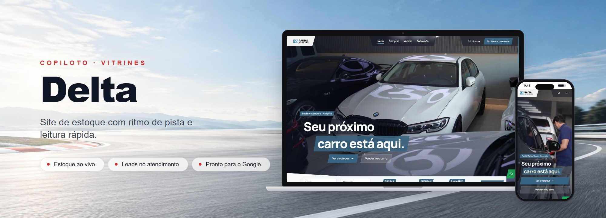
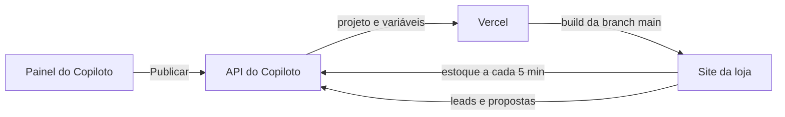

<p align="center">
  <picture>
    <source media="(prefers-color-scheme: dark)" srcset=".github/assets/logo-light.png">
    
  </picture>
</p>

<h3 align="center">O site de estoque de cada loja, com ritmo de pista.</h3>

<p align="center">Um tema, um projeto por loja e o estoque sempre atualizado. Sem cadastro duplicado e sem deploy manual.</p>

<p align="center">
  
  
  
  
  
  
  
</p>

<p align="center">
  <a href="https://www.ocopiloto.com.br">Site do Copiloto</a> ·
  <a href="https://app.ocopiloto.com.br">Painel</a> ·
  <a href="https://github.com/ocopiloto/copiloto-vitrine-horizon">Tema Horizon</a> ·
  <a href="https://github.com/ocopiloto/copiloto-vitrine-templates">Todos os temas</a>
</p>

<p align="center">
  
</p>

---

## O que faz

A Vitrine Delta é um dos temas de site das lojas que assinam o Copiloto. Tudo lembra uma pista: a abertura em corte diagonal, os títulos em placas inclinadas, as marcas numa grade de largada e o estoque em faixas de preço. O lojista configura a vitrine no painel. O Copiloto publica o site na Vercel, em `<loja>.meucopiloto.com` ou no domínio próprio da loja.

- **Estoque ao vivo.** Os veículos vêm da API pública do Copiloto. O site atualiza o estoque a cada 5 minutos, sem novo deploy.
- **Leads no atendimento.** O formulário do veículo registra o contato e abre a conversa no WhatsApp. O "Vender", com até 8 fotos, chega direto no atendimento.
- **Busca completa.** Na página inicial, painel com marca, carroceria e réguas de preço e de ano. No estoque, busca, marca, preço e ano com régua, um painel com tipo, carroceria, câmbio, combustível, cor e km, ordenação e resultados em faixas de preço com carga contínua.
- **Carro, moto ou caminhão.** Os textos e a ficha técnica seguem o tipo de veículo da loja.
- **Pronto para o Google.** Metadados por página, JSON-LD de veículo e de loja, `sitemap.xml`, `robots.txt` e imagem de compartilhamento gerada no build.
- **Cores sempre legíveis.** O tema escolhe a cor do texto pelo contraste com o fundo (WCAG), nas faixas na cor da loja, nos botões e no rodapé.

## Como funciona



1. No painel, a loja escolhe o tema **Delta**, as cores, o banner e os textos. Depois clica em **Publicar**.
2. A API cria ou atualiza o projeto `vitrine-<slug>` na Vercel, grava as variáveis da loja e inicia um deploy da branch `main` deste repositório.
3. No build, `scripts/prepare-site.mjs` lê a configuração e baixa logo, banner, vídeo e fotos. Ele converte as imagens para WebP, otimiza o vídeo e gera o favicon e a imagem de compartilhamento.
4. O site entra no ar. Uma mudança de configuração gera um novo deploy. Uma mudança de estoque não precisa de deploy.

## Páginas

| Rota | Conteúdo |
| --- | --- |
| `/` | Abertura em corte diagonal com vídeo ou foto, painel de réguas, marcas em grade de largada, carrocerias, vitrine com abas, venda em três toques, avaliações em rolo, contato sobre o mapa e fita de chegada |
| `/comprar` | Barra presa com busca, réguas e filtros, ordenação e resultados em faixas de preço com carga contínua |
| `/veiculo/<slug>` | Fotos empilhadas que abrem em tela cheia, placa presa com preço e formulário, ficha em abas e outros carros |
| `/vender` | Pista vertical com as 4 etapas e envio de até 8 fotos |
| `/sobre-nos` | Abertura com números em placas, capítulos com índice, galeria e contato |
| `/preview` | Prévia usada pelo painel do Copiloto. Fica fora do Google |

O [`ui-spec-sheet.pdf`](ui-spec-sheet.pdf) tem o desenho técnico de cada página, em 9 folhas. Ele mostra a grade, os espaçamentos, os raios e o que muda em cada breakpoint, com os valores medidos na página em 1440 px e em 390 px.

## Aparência

A loja controla as cores, a fonte, o banner (imagem ou vídeo), o estilo do header e as seções visíveis. O tema garante a leitura:

- O header é feito de placas no topo. Com 56 px de rolagem elas viram uma aba só; abaixo de lg o menu vira cortina.
- A paleta da loja vale para todos os componentes. Campos e botões têm cantos leves de 6 px; lâminas e placas inclinadas fazem a identidade do tema.
- O texto das faixas na cor da loja e do rodapé é calculado pelo contraste com essa cor.

## Privacidade e segurança

- O aviso de cookies segue a LGPD. Google Analytics, Meta Pixel e o mapa do Google só carregam depois do consentimento; o mapa também abre pelo botão Mostrar o mapa.
- `CLIENT_API_TOKEN` é a chave pública da vitrine. Ela só lê os dados que a vitrine já mostra e só envia leads e propostas.
- Todas as páginas têm cabeçalhos de segurança. Outro domínio não consegue embutir o site.
- A rota `/preview` só aceita mensagens e iframes de `*.ocopiloto.com.br` e de `localhost`.

## Desenvolvimento

Requisitos: Node.js 24 e npm.

```sh
npm ci
npm run dev
```

`npm run dev` abre a demonstração com o estoque estático da Radial (`VITRINE_DEMO=true`). Na demo, os envios de leads e propostas são bloqueados. Para ver o estoque real de uma loja, crie um `.env.local` e use `npm run dev:integrated`:

```sh
CLIENT_API_URL=https://api.ocopiloto.com.br
CLIENT_SLUG=<slug-da-vitrine>
CLIENT_API_TOKEN=<client-id-da-vitrine>
```

| Variável | Uso |
| --- | --- |
| `CLIENT_API_URL` | Endereço da API pública do Copiloto |
| `CLIENT_SLUG` | Slug da vitrine |
| `CLIENT_API_TOKEN` | Chave pública da vitrine (`client_id`). Vai no cabeçalho `x-public-key` |
| `SITE_CONFIG` | JSON com a configuração da loja. Só o build lê. A API grava esse valor na Vercel |
| `VITRINE_DEMO` | `true` liga a demonstração. Os scripts `dev`, `dev:demo`, `build:demo` e `start:demo` já definem |

Sem `CLIENT_API_URL`, `CLIENT_SLUG` e `CLIENT_API_TOKEN` o modo integrado mostra o estoque vazio. Uma lista vazia nesse modo não é o estoque da loja.

Para reproduzir o build de uma loja:

```sh
SITE_CONFIG="$(cat configuracao-da-loja.json)" node scripts/prepare-site.mjs
npm run dev:integrated
```

> [!WARNING]
> `prepare-site.mjs` reescreve `site-config.json` e cria `public/<slug>/`. Não faça commit desses arquivos.

| Comando | O que faz |
| --- | --- |
| `npm run dev` | Demonstração com o estoque da Radial |
| `npm run dev:integrated` | Servidor de desenvolvimento com a API da loja |
| `npm run lint` | ESLint |
| `npm run build` | Roda `prepare-site.mjs` e o build de produção |
| `npm run build:demo` | Build da demonstração, sem o prepare |
| `npm start` / `npm run start:demo` | Serve o build de produção ou o da demonstração |
| `npm run check:stock` | Teste rápido do estoque no site em execução (`VITRINE_BASE_URL`) |

## Estrutura

```text
scripts/prepare-site.mjs   Prepara a configuração e as mídias da loja no build
scripts/                   Demonstração e verificações (estoque, contraste, fluxo, teclado, rolagem)
src/app/                   Rotas (App Router), sitemap, robots e prévia
src/theme/                 Componentes do tema, peças comuns em base/ e o CSS (delta*.css)
src/components/            Banner, consentimento, rastreamento, mapa e ícones
src/lib/                   API, cores, aparência, SEO e utilitários
src/demo/                  Estoque de demonstração
public/                    Imagens padrão e de demonstração. As da loja são geradas no build
site-config.json           Configuração de exemplo para desenvolvimento
ui-spec-sheet.pdf          Desenho técnico de cada página do tema
```

## Publicação

- A branch `main` é a versão de produção. Com o tema cadastrado no painel, cada loja recebe o código novo no próximo deploy dela.
- Antes de mesclar, rode `npm run lint` e `npm run build:demo`, e `npm run build` com a configuração de uma loja real.
- Uma mudança visual vale para todas as lojas deste tema. Teste com uma loja de fundo claro e com uma de fundo escuro.

> [!IMPORTANT]
> O `vercel.json` deste repositório publica a demonstração (`npm run build:demo`). Antes de ligar o tema às lojas, troque o comando de build para `npm run build` ou retire o arquivo, como no Horizon.

Situação em 29/10/2026: revisão visual de 28/10 entregue; a escolha das categorias continua aberta. O tema segue o contrato do Horizon de 26/10; faltam as mudanças de aparência de 28/10. Também falta cadastrar o tema no painel e homologar com a API real.

## Licença

Software proprietário da COPILOTO INOVA SIMPLES (I.S.). O uso é restrito à equipe e a parceiros autorizados. Veja [LICENSE](LICENSE). Ícones, avisos e mídia de terceiros estão em [THIRD_PARTY_NOTICES.md](THIRD_PARTY_NOTICES.md).

<br>

<p align="center">Feito com ❤️ pela equipe Copiloto</p>
